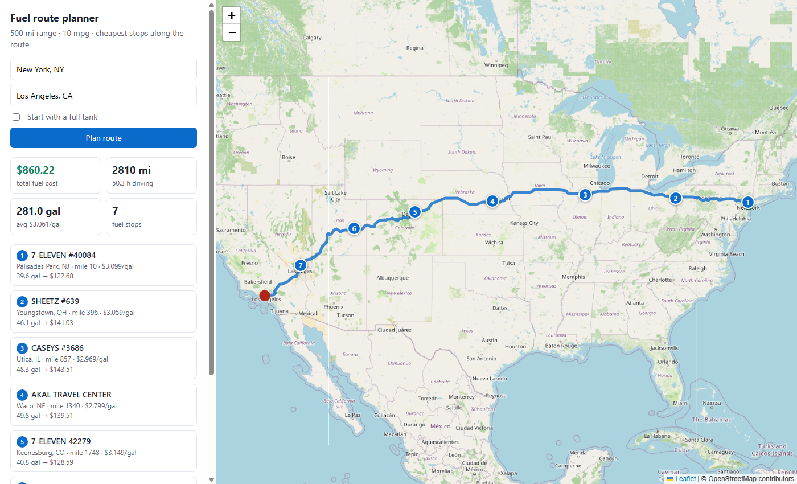

# Fuel Route API

A Django REST API that takes a start and a finish location in the USA and returns:

- the driving route, as GeoJSON plus an interactive map page
- the most cost-effective fuel stops along it, for a vehicle with a **500-mile range**
- the **total fuel cost** of the trip at **10 miles per gallon**

Each trip makes **one call to the routing API**, and none at all when the route is already cached. Station
geocoding is done offline when the price list is imported. Locations typed as a city, a ZIP or coordinates
are also geocoded offline.

```
GET /api/route/?start=New York, NY&finish=Los Angeles, CA

→ 2,810 mi · 7 fuel stops · $860.22 for 281.0 gal · 1 routing call · 0 geocoding calls
```



---

## Quick start

Requires Python 3.12+ (the minimum for Django 6.1). First copy the provided
`fuel-prices-for-be-assessment.csv` into [`data/`](data). It isn't committed because it's licensed OPIS data.

```bash
python -m venv .venv
source .venv/bin/activate            # Windows: .venv\Scripts\activate
pip install -r requirements.txt
python manage.py migrate
python manage.py import_fuel_prices  # ~3 s, fully offline
python manage.py runserver
```

- JSON API: <http://localhost:8000/api/route/?start=New%20York,%20NY&finish=Los%20Angeles,%20CA>
- Map: <http://localhost:8000/api/route/map/?start=New%20York,%20NY&finish=Los%20Angeles,%20CA>
- Postman: import [`postman_collection.json`](postman_collection.json)
- Tests: `python manage.py test planner` (30 tests, no network needed)

No API keys are needed. Both external services are free:
[OSRM](https://project-osrm.org/) for routing and, only as a fallback for free-form addresses,
[Nominatim](https://nominatim.org/) for geocoding.

---

## API

### `GET /api/route/` or `POST /api/route/`

The same parameters work as a query string (GET) or as a JSON body (POST).

| Parameter | Type | Default | Description |
|---|---|---|---|
| `start`, `finish` | string | required | `"City, ST"`, `"City, State"`, a ZIP code, `"lat,lon"` or a free-form US address |
| `start_with_full_tank` | bool | `false` | `false`: the tank starts empty, so `total_fuel_cost` covers the whole trip. `true`: you leave with 500 mi of fuel and only buy top-ups |
| `stop_penalty` | number | `5` | Dollars a stop must save to be worth making (see [Optimisation](#how-the-fuel-stops-are-chosen)). `0` gives the cheapest possible plan |
| `corridor_miles` | number | `10` | How far from the route a station may be (1–50) |
| `include_geometry` | bool | `true` | Include the route LineString (about 200 KB for a coast-to-coast trip) |

Example response (trimmed):

```json
{
  "start":  {"query": "New York, NY", "label": "New York, NY", "lat": 40.66, "lon": -73.94, "source": "gazetteer"},
  "finish": {"query": "Los Angeles, CA", "label": "Los Angeles, CA", "lat": 34.02, "lon": -118.41, "source": "gazetteer"},
  "route": {
    "distance_miles": 2810.4,
    "duration_hours": 50.31,
    "geometry": {"type": "LineString", "coordinates": [[-73.94, 40.66], "..."]}
  },
  "vehicle": {"max_range_miles": 500, "miles_per_gallon": 10, "starts_with_full_tank": false,
              "corridor_miles": 10, "stop_penalty_usd": 5},
  "fuel_stops": [
    {
      "stop_number": 4, "station_id": 68368, "name": "AKAL TRAVEL CENTER", "address": "I-80 EX 360",
      "city": "Waco", "state": "NE", "latitude": 40.897, "longitude": -97.4617,
      "price_per_gallon": 2.799, "miles_from_start": 1340.3, "miles_off_route": 5.2,
      "fuel_on_arrival_miles": 0.0, "gallons": 49.84, "cost": 139.51
    }
  ],
  "summary": {"total_fuel_cost": 860.22, "total_gallons": 281.04, "number_of_stops": 7,
              "average_price_per_gallon": 3.061, "stations_considered": 459},
  "meta": {
    "external_api_calls": {"routing": 1, "geocoding": 0},
    "route_cache_hit": false,
    "timing_ms": {"geocode_and_route": 1684.9, "fuel_optimisation": 76.8, "total": 1761.7}
  },
  "map_url": "http://localhost:8000/api/route/map/?start=New+York%2C+NY&finish=Los+Angeles%2C+CA"
}
```

Errors:

| Status | When |
|---|---|
| `400` | Missing or invalid parameters, a location that can't be found, or a location outside the USA (e.g. `"Toronto, ON"`) |
| `422` | Some stretch of the route is longer than 500 mi with no station from the price list, e.g. Anchorage → Seattle through Canada |
| `502` | The routing service failed or found no drivable route |

### `GET /api/route/map/`

Takes the same parameters and returns a Leaflet/OpenStreetMap page showing the route, numbered stops
(click one for price, gallons and cost) and a summary panel. The page reads the cached route, so opening
it after an API call costs **no** extra routing call. `map_url` in every response links straight to it.

### `GET /api/health/`

Returns `{"status": "ok", "stations_loaded": 6626}`.

---

## How it works

```
start, finish ─► geocode ─► OSRM route (1 call, cached) ─► stations near the route ─► optimiser ─► JSON / map
               (offline)                                      (numpy, in memory)       (exact DP)
```

### 1. Fuel price data → geocoded stations (import time, once)

`python manage.py import_fuel_prices` loads the provided CSV:

- **Drops non-US rows.** 620 rows are Canadian provinces (AB, ON, BC…), which can't be on a US route.
- **Merges duplicates.** 7,531 US rows become 6,626 truck stops by OPIS ID. Many stops are listed several
  times with different prices; the lowest is kept (`--price-strategy avg` keeps the mean instead).
- **Geocodes offline.** The CSV has addresses like `"I-44, EXIT 283 & US-69"` but no coordinates.
  [`scripts/build_gazetteer.py`](scripts/build_gazetteer.py) compiles the public-domain **US Census 2024
  Gazetteer** (places, townships and ZIP codes) into [`planner/data/us_gazetteer.csv.gz`](planner/data)
  (1.3 MB). Names are normalised so that `Mc Calla` = `McCalla`, `Saint Johns` = `St. Johns`, and
  `Nashville` matches `Nashville-Davidson metropolitan government (balance)`. That matches 97% of stations.
  The other 132 towns, mostly unincorporated places like Breezewood, PA, were resolved once with
  Nominatim (`--geocode-missing`); 5 were fixed by hand. All of these are committed in
  [`geocode_overrides.csv`](planner/data/geocode_overrides.csv), so **the import needs no network**.

### 2. Geocoding the request (usually 0 API calls)

`"lat,lon"`, ZIP codes and `"City, ST"` / `"City, State"` are looked up in the in-memory gazetteer.
Only free-form addresses ("Space Needle, Seattle") go to Nominatim, restricted to the US and cached for 30 days.

### 3. Routing (exactly 1 API call)

The app makes one OSRM `route` request with `overview=full&geometries=polyline6`. Polyline6 is 5× smaller on the
wire than GeoJSON (166 KB vs 818 KB coast to coast), which roughly halves the call time, and it's decoded with
a vectorised numpy decoder. Routes are cached for 7 days in Django's file cache, which is shared across
worker processes and survives restarts, so repeating a trip, or opening its map, costs 0 calls.

### 4. Finding stations along the route (~30 ms)

All 6,626 stations are held in memory as numpy arrays, loaded once at startup from `wsgi.py`. The route is
resampled to roughly 1 point per mile. Stations are then filtered in three steps:

1. A bounding-box filter around the route.
2. A coarse pass against every ~5th route point. Its slack is provably lossless.
3. An exact nearest-route-point search for the survivors, using unit-vector dot products (`argmax(S·Rᵀ)`
   equals minimum great-circle distance).

This gives each station's **distance along the route** and **distance off the route**. Stations within
`corridor_miles` become candidates. The default is 10 mi, because station coordinates are town centroids.

### 5. How the fuel stops are chosen

This is the classic gas-station problem. The optimiser minimises

```
total fuel cost + stop_penalty × number_of_stops
```

using an **exact dynamic program over (station, fuel level)**:

- Fuel is tracked in 1-mile units (0.1 gal).
- Walking the stations in route order, `after[t]` is the cheapest way to leave the current station with
  `t` miles of fuel.
- Buying is a prefix minimum: `min over f ≤ t of arrive[f] + (t − f)·price`. Each station therefore
  costs O(range) numpy work, about 5–15 ms for a 450-station trip.
- Positions are rounded to whole miles, so the DP keeps a 1-mile reserve. After backtracking, purchases are
  re-sized from the exact distances, so every leg is exactly feasible.

The stop penalty is there because the pure-cost optimum is impractical. On NY → LA it says to stop **17 times**,
often for 1–2 gallons whenever the next station is a cent cheaper, to save $7.70. With the default $5 penalty you get:

| `stop_penalty` | stops | total fuel cost |
|---|---|---|
| 0 (pure cheapest) | 17 | $852.52 |
| 2 | 8 | $857.06 |
| **5 (default)** | **7** | **$860.22** |
| 25 | 7 | $860.22 |

The penalty only shapes the plan. It is never added to `total_fuel_cost`.

The DP is verified against an independent implementation of the textbook greedy algorithm (optimal when
the penalty is 0) on hundreds of random instances ([`planner/tests/`](planner/tests)). A replay checks that
the tank never runs dry and never overfills.

### Performance

Measured on a laptop against the public OSRM server:

| | first request | repeated request (cached route) |
|---|---|---|
| NY → LA, 2,810 mi | ~1.8 s (≈1.7 s is the OSRM call) | ~60 ms server time |
| Dallas → Houston | ~0.4 s | ~25 ms |

Everything except the routing call (geocoding, corridor search, optimisation and serialisation) takes
well under 100 ms. For lower latency, point `OSRM_BASE_URL` at a self-hosted OSRM.

---

## Assumptions

- **The tank starts empty by default**, so `total_fuel_cost` is the full trip's fuel bill. The first fill-up
  is at one of the stations within the first 25 route miles. The few miles driven to reach it are billed at
  that station's price. Pass `start_with_full_tank=true` to model leaving home full instead.
- **Station locations are town centroids** from the Census gazetteer, not exact exit coordinates, because
  the CSV has no coordinates. That is why the corridor defaults to 10 mi. `miles_off_route` is reported
  for every stop.
- **Detour distance to a station is not added to the route.** Stations are at most `corridor_miles` off
  the route, and most are 0–5 mi off.
- **The lowest listed price is used when a stop appears more than once** in the CSV.
- **You arrive at the destination as empty as possible.** No fuel is bought that isn't needed.

---

## Configuration

Settings can be overridden with environment variables:

| Variable | Default |
|---|---|
| `OSRM_BASE_URL` | `https://router.project-osrm.org` |
| `NOMINATIM_URL` | `https://nominatim.openstreetmap.org/search` |
| `GEOCODER_FALLBACK_ENABLED` | `1` (set `0` to accept only offline-resolvable inputs) |
| `FUEL_CORRIDOR_MILES` | `10` |
| `FUEL_STOP_PENALTY_USD` | `5` |
| `DJANGO_SECRET_KEY`, `DJANGO_DEBUG`, `DJANGO_ALLOWED_HOSTS`, `DJANGO_CACHE_DIR` | dev defaults |

## Project layout

```
fuel_route_api/            Django project (settings, urls, wsgi warm-up)
planner/
  models.py                FuelStation
  views.py                 RouteView (GET/POST), RouteMapView, HealthView
  serializers.py           request validation
  services/
    trip_planner.py        orchestration: geocode -> route -> stations -> optimiser -> response
    geocoding.py           lat/lon, ZIP, "City, ST" (offline) -> Nominatim fallback
    gazetteer.py           in-memory Census gazetteer
    routing.py             OSRM client, polyline6 decoder, route cache
    stations.py            in-memory numpy station index, corridor search
    optimizer.py           exact DP fuel-stop optimiser
    geo.py, textnorm.py    geometry and place-name helpers
  management/commands/import_fuel_prices.py
  templates/planner/map.html   Leaflet map
  data/                    gazetteer + geocode overrides
  tests/                   optimiser, geometry/geocoding, API (mocked routing), import
scripts/build_gazetteer.py rebuilds planner/data/us_gazetteer.csv.gz from Census files
data/                      put fuel-prices-for-be-assessment.csv here (not committed)
postman_collection.json
```
